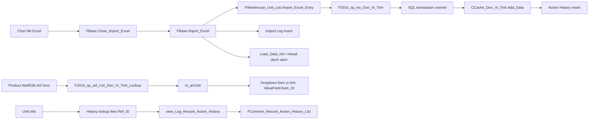

# Xác minh Cache, Lookup và Action History của Đơn vị tính

> **Cập nhật trạng thái 2026-10-20:** Gate Phase 1/Phase 4 và yêu cầu database runtime trong snapshot cũ đã được người dùng thay đổi phạm vi; chúng không còn chặn migration source. Kết quả mới nhất và các giới hạn `RUNTIME_PENDING` / `ACTION_HISTORY_SCOPE_PENDING` nằm trong [báo cáo migration hoàn tất](company-style-master-fe-migration-complete.md).

Ngày xác minh: 2026-10-20  
Phạm vi: Phase 1 theo yêu cầu trong task; Phase 2 chưa được bắt đầu.

## Phạm vi và giới hạn

- Worktree đã có thay đổi từ các lượt làm việc trước. Giữ nguyên các thay đổi đó và 12 file benchmark log đang bị xóa; không reset, clean, stage, commit hoặc push.
- `TKS_INTEGRATION_CONNECTION_STRING` không được cấu hình. Không kết nối database mặc định, database development dùng chung hoặc production.
- Báo cáo phân biệt source/in-memory evidence với runtime database/UI evidence. Build và test hiện có không chứng minh import end-to-end.

## A. Architecture

- Import Excel dùng hook của `FBase`: `FBase.razor:1723-1735, 341-417` gọi `Import_Excel_Entry`, ghi Import Log, kết thúc queue và gọi `Load_Data_Init`.
- Hook Đơn vị tính nằm ở `FWarehouse_Unit_List.razor:111-236`. Mỗi dòng gọi insert SP trong transaction; chỉ sau `Commit()` mới gọi `CCache_Don_Vi_Tinh.Add_Data`, tăng số thành công rồi ghi Action History (`:149-197`). Lỗi insert rollback trước khi tới nhánh cập nhật cache.
- Cache nạp bằng `F2016_sp_sel_List_Don_Vi_Tinh_For_Cache` (`CCache_Don_Vi_Tinh.cs:15-26`). Cache giữ danh sách, index theo ID và tên; `Add_Data`, `Update_Data`, `Delete_Data`, getter và `List_Data` ở `:28-89`. Schema source khai báo unique index tên Đơn vị tính tại `Database/WarehouseModule.Schema.sql:174`.
- Lookup dùng trong form Sản phẩm không đọc cache. `CDM_Don_Vi_Tinh_Controller.F2016_sp_sel_List_Don_Vi_Tinh_Lookup` gọi stored procedure lookup (`CDM_Don_Vi_Tinh_Controller.cs:65-75`; `Database/WarehouseModule.Procedures.sql:3834`). `FWarehouse_1_Warehouse_List.Load_Lookups_Async` nạp `m_arrUnit`; form nhận danh sách này và dropdown dùng `ValueField=Auto_ID`, `TextField=Name` (`FWarehouse_3_Warehouse_Edit.razor:82, 165`).
- Đã sửa điểm stale khi mở form Sản phẩm: trích phần nạp Đơn vị tính thành `Load_Unit_Lookup()` và gọi lại trước khi mở Add/Edit (`FWarehouse_1_Warehouse_List.razor:602-632, 826-829, 997-1000`). Nếu lookup lỗi, hiển thị lỗi và không mở form với danh sách cũ. Modal đang mở không tự nhận sự kiện import ở component khác; cần đóng rồi mở lại.
- Action History và Import Log là hai luồng riêng. `CCommon_Controller.FCommon_Insert_Action_History` ánh xạ Ref_ID, hành động, môi trường, người dùng, mã/tên chức năng và nội dung rồi gọi `FQ_425_RAH_sp_ins_Insert` (`CCommon_Controller.cs:24-42`). Unit Info truy vấn theo `r_iAuto_ID` và hiển thị component lịch sử (`FWarehouse_Unit_Info.razor:41-62`). Query SQL dùng `view_Log_Record_Action_History` lọc `Ref_ID` (`Database/CoreLogActionHistory.Procedures.sql:5-16`).
- `FBase.Import_Excel` ghi riêng `FQ_422_IE_sp_ins_Insert` với function, URL file, trạng thái, ghi chú đếm thành công/thất bại, user và function (`FBase.razor:375-401`).

## B. Detailed verification matrix

| ID | Component | Expected | Actual theo source/test | Evidence | Result |
|---|---|---|---|---|---|
| C01 | Cache sau commit | Chỉ thêm cache khi insert transaction commit; cache tra được ID/key và không thêm trùng ID. | Source gọi `Commit()` trước `Add_Data`. Test in-memory hiện có thao tác trực tiếp cache Đơn vị tính: add, duplicate ID, tra cứu, update tên/key, xử lý key rỗng/null, delete và list. Không chạy import có đối chiếu SQL. | `FWarehouse_Unit_List.razor:149-179`; `CCache_Don_Vi_Tinh.cs:28-89`; `WarehouseDmCacheContractTests.cs:35, 91-166` | **NOT_VERIFIED** — source và in-memory đạt; runtime SQL/cache chưa xác minh. |
| C02 | Cache khi rollback | Insert thất bại/rollback không được tạo cache entry. | `Rollback()` rồi rethrow trong catch; `Add_Data` nằm sau transaction scope, vì vậy nhánh lỗi không đi tới cache. Chưa chạy lỗi SP/rollback trên test DB. | `FWarehouse_Unit_List.razor:152-179` | **NOT_VERIFIED** — source xác nhận thứ tự; runtime transaction chưa xác minh. |
| L01 | Refresh lookup | Lookup phản ánh đơn vị mới sau import khi form được mở hoặc mở lại. | Lookup đọc trực tiếp SP từ SQL, không đọc static cache. Đã thêm refresh trước Add/Edit Sản phẩm; mở lại form sẽ lấy lại danh sách. Chưa xác minh SQL trả về bản ghi mới trên runtime. | `CDM_Don_Vi_Tinh_Controller.cs:65-75`; `F2016_sp_sel_List_Don_Vi_Tinh_Lookup` tại `WarehouseModule.Procedures.sql:3834`; `FWarehouse_1_Warehouse_List.razor:602-632, 826-829, 997-1000` | **NOT_VERIFIED** — code path đã sửa; runtime lookup chưa chạy. |
| L02 | Dropdown Sản phẩm | Dropdown hiển thị tên và lưu đúng Auto_ID, không có dòng trùng sau refresh. | Component map nạp về `m_arrUnit`; Telerik dropdown dùng `Auto_ID` làm value. Chưa thao tác chọn/kiểm tra dữ liệu sau import trong browser. | `FWarehouse_3_Warehouse_Edit.razor:82, 165`; `FWarehouse_1_Warehouse_List.razor:602-607` | **NOT_VERIFIED** — cấu hình source xác nhận; UI runtime chưa kiểm tra. |
| H01 | Action History | Sau commit ghi đúng Ref_ID/Auto_ID, user, function, action; lỗi ghi history không báo rollback dữ liệu đã commit; Info xem được lịch sử. | Gọi history sau commit với `Ref_ID=Auto_ID`, action “Import Excel - Thêm Mới”, user/function hiện hành và nội dung key. Lỗi history được gom thành cảnh báo riêng, không rollback insert và không trừ số thành công. Info truy vấn theo Ref_ID. Chưa có bằng chứng record thực tế/timestamp. | `FWarehouse_Unit_List.razor:178-197, 208-223`; `CCommon_Controller.cs:24-42`; `FWarehouse_Unit_Info.razor:41-62`; `CoreLogActionHistory.Procedures.sql:5-16` | **NOT_VERIFIED** — source path đúng; insert/storage/runtime row chưa xác minh. |
| H02 | Import Log | Ghi riêng function, user, status, file reference và số dòng theo logic import. | `FBase` tính status/ghi chú từ success/error count rồi gọi controller Import Log. SP insert chưa có body trong source; không kiểm tra được row thực tế hoặc table từ lượt này. | `FBase.razor:375-401`; parity report đánh dấu `FQ_422_IE_sp_ins_Insert` DB_ONLY tại `stored-procedure-source-db-parity-report.md:249` | **NOT_VERIFIED** — source xác nhận payload/call; database log chưa xác minh. |

### Cache semantics được xác nhận trong source

- `Add_Data` bỏ qua null, ID bằng 0 và Auto_ID đã có; map tên dùng lowercase và chỉ giữ entry đầu tiên cho key trùng. Database schema source có unique index tên, nhưng trạng thái index trên DB thật chưa được kiểm tra.
- `Update_Data` xóa entry cũ theo ID rồi thêm lại; `Delete_Data` xóa list/ID và xóa name key khi key đang trỏ đúng ID.
- Test `Cache_add_update_delete_and_list_keep_ID_and_business_indexes_consistent` chạy trên cache in-memory thật, không phải test giả kiểm tra chuỗi source. Nó không kiểm chứng transaction SQL hoặc import hook.

## C. Issues

- **BLOCKER — Phase 1 gate:** Không có `TKS_INTEGRATION_CONNECTION_STRING`; các yêu cầu đối chiếu SQL/cache, import, lookup dropdown, Action History và Import Log trong runtime chưa thể xác minh an toàn.
- **MEDIUM — Đã sửa:** Form Sản phẩm dùng `m_arrUnit` đã preload và không nạp lại khi mở Add/Edit. Đã thêm refresh lookup trước khi mở form; lookup lỗi được hiển thị và không mở form với danh sách cũ.
- **MEDIUM — Bằng chứng DB chưa có:** `FQ_425_RAH_sp_ins_Insert` và `FQ_422_IE_sp_ins_Insert` được báo cáo DB_ONLY trong parity report; không có procedure body tương ứng trong checked-in SQL scripts. Do đó không thể xác nhận table/storage, timestamp hoặc bản ghi sau import chỉ từ source này.
- **LOW — Giới hạn UI:** Modal Product đang mở không tự refresh khi Unit import ở component khác. Đóng/mở lại modal sẽ chạy lookup mới; không có cơ chế push giữa các component được tìm thấy trong đường đi này.

## D. Test evidence

- Build: `dotnet build TKS_Thuc_Tap_V11_Web_Danh_Muc/TKS_Thuc_Tap_V11_Web_Danh_Muc.csproj --no-restore -clp:ErrorsOnly` — **PASS**, 0 errors, 21 warnings, 8.85 giây.
- Tests: `dotnet test TKS_Thuc_Tap_V11_Data_Access.Tests/TKS_Thuc_Tap_V11_Data_Access.Tests.csproj --no-restore --filter "FullyQualifiedName~WarehouseUiWorkflowTests|FullyQualifiedName~WarehouseNavigationTests|FullyQualifiedName~WarehouseDmCacheContractTests" -clp:ErrorsOnly --logger "console;verbosity=minimal"` — **PASS**, 54 passed, 0 failed, 0 skipped, 511 ms. Bao gồm `WarehouseDmCacheContractTests`, `WarehouseUiWorkflowTests` và `WarehouseNavigationTests`.
- `TKS_INTEGRATION_CONNECTION_STRING`: **ABSENT**. Không chạy integration test và không kết nối database khác.
- `UnitImportRuntimeIntegrationTests` hiện dùng `CWarehouseUnitImportService.PreviewAsync/ConfirmAsync` (`UnitImportRuntimeIntegrationTests.cs:43-65`), tức đường import Preview/Confirm legacy; test này không chứng minh hook đang chạy của `FBase.Import_Excel_Entry`.
- Không thực hiện browser UAT hoặc kiểm tra row SQL/action history/import log. Vì vậy build/test pass không được nâng thành runtime PASS.
- CodeGraph được sync sau chỉnh sửa source; 2 file đã được đồng bộ.

## E. Phase Next reassessment — 2026-10-20

### Verification matrix

| Requirement | Source Evidence | In-memory Test | SQL Evidence | Browser Evidence | Status |
|---|---|---|---|---|---|
| Unit cache add/update/delete and indexes | `FWarehouse_Unit_List.razor:149-179`; `CCache_Don_Vi_Tinh.cs:28-89` | `WarehouseDmCacheContractTests.Cache_add_update_delete_and_list_keep_ID_and_business_indexes_consistent` passed in the 168-test selection | No active importer DB run | Not run in this session | `SOURCE_VERIFIED` + `IN_MEMORY_TEST_PASS` |
| Unit insert rollback does not update cache | Rollback/rethrow is inside the transaction; cache add is after commit at `FWarehouse_Unit_List.razor:149-179` | Static source assertion only; no in-memory transaction simulation | Not run | Not run | `SOURCE_VERIFIED`; SQL `NOT_VERIFIED` |
| Product unit lookup refresh on Add/Edit | `Load_Unit_Lookup` / `Try_Refresh_Product_Unit_Lookup` at `FWarehouse_1_Warehouse_List.razor:602-622`; called at Add/Edit entry points | No test directly exercises refresh results; selected tests only verify adjacent source/UI contracts | No lookup query run | Not run | `SOURCE_VERIFIED`; SQL/browser `NOT_VERIFIED` |
| Product dropdown stores Auto_ID | `FWarehouse_3_Warehouse_Edit.razor` binds `ValueField=Auto_ID`, `TextField=Name` for category and unit | No runtime selection test | No DB result comparison | Not run | `SOURCE_VERIFIED`; runtime `NOT_VERIFIED` |
| Active Unit import transaction/cache/history | Active path is `FCommon_Import_Excel` → `FBase.Close_Import_Excel` → `FBase.Import_Excel` → `FWarehouse_Unit_List.Import_Excel_Entry`; success is recorded after commit/cache update | `UnitExcelImportUiTests` checks source wiring/order; it does not execute the SQL path | No active importer SQL run | Not run | `SOURCE_VERIFIED`; SQL `NOT_VERIFIED` |
| Unit Action History payload and display | `CCommon_Controller.cs:24-42`; `FWarehouse_Unit_Info.razor:61-62`; lookup SQL at `Database/CoreLogActionHistory.Procedures.sql:5-16` | No in-memory history integration | Insert SP/storage and actual rows unavailable | Not run | `SOURCE_VERIFIED`; SQL/browser `NOT_VERIFIED` |
| Import Log payload and status | `FBase.razor:341-417`; controller calls `FQ_422_IE_sp_ins_Insert` with function, file URL, status/count note, and user | Source path only | Insert SP body/row not available | Not run | `SOURCE_VERIFIED`; SQL `NOT_VERIFIED` |
| Integration test target safety | Runtime appsettings are not used. `WarehouseTestDatabase` now delegates to the strict target guard; missing configuration fails closed. | `ProductImportDatabaseSafetyTests` + `WarehouseTestDatabaseSafetyTests`: 9 passed | No connection opened; target existence/schema not verified | Not applicable | `SOURCE_VERIFIED` + `IN_MEMORY_TEST_PASS`; runtime `NOT_VERIFIED` |
| Cross-entity history scope | Master tables define separate `IDENTITY` keys (`Database/WarehouseModule.Schema.sql:38-95`); history query filters only `Ref_ID` (`CoreLogActionHistory.Procedures.sql:5-16`). The read method has 28 callers. | No test covers entity scoping | Live view/storage and actual collisions not verified | Not run | `SOURCE_VERIFIED` risk; runtime `NOT_VERIFIED` |

### Environment and blocker resolution

- `TKS_INTEGRATION_CONNECTION_STRING` is absent. The application `appsettings.json` contains a runtime connection setting and `Program.cs:39` loads it; its value was not read or used for tests.
- `ProductImportTestDatabase` has an allowlist for the designated test server/database, but the current environment cannot confirm the server is reachable, the database exists, or that required schema/SP/view definitions are installed.
- `WarehouseTestDatabase` previously fell back to `TKS_Thuc_Tap_V11_GiaiDoan2`. That unsafe fallback is removed. It now requires an explicit connection and delegates to the same strict allowlist. No SQL connection was made.
- `UnitImportRuntimeIntegrationTests` still exercises `CWarehouseUnitImportService.PreviewAsync/ConfirmAsync`; it does not prove the active `FBase.Import_Excel_Entry` path, cache update, Action History, or Import Log.
- No test-database provisioning script or checked-in body for `FQ_425_RAH_sp_ins_Insert` / `FQ_422_IE_sp_ins_Insert` was found in the relevant source tree. No SQL was deployed.

### Unresolved risks and Phase 4 gate

1. **High — Action History may mix entities.** Each master table has its own identity sequence, while `FCommon_Sys_sp_sel_List_Log_Record_Action_History` filters only by `Ref_ID`. A record with the same numeric ID in another entity can therefore be returned in the current Info dialog. This is structurally possible from source; actual rows were not inspected. The procedure has 28 callers, so do not change the shared SP/API until every caller and the deployed DB contract are assessed. Proposed remediation: add a stable entity/function scope to the history query and update all callers together, then validate against the approved DB.
2. **Medium — remaining Master CRUD is not on the same save hook.** The current shared `FWarehouse_3_Warehouse_Edit` uses `DataAnnotationsValidator` and callbacks into `Save_Master_Operation_Async`; it does not use the `FBase.Save_Data` Add/Update/history hook or preserve `r_objSource`/`r_objDes` diffs. The master entity models have length annotations but no required annotations, while the import validators reject blank code/name. Review localized required validation and the desired audit behavior before calling the four-module migration complete.
3. **UI mismatch still present in the current dirty tree.** The four master routes share `FWarehouse_1_Warehouse_List`; Import is currently passed as an item in `Layout_Tool_Button` (Công Cụ), while `F2003_1_Chu_Hang_List` uses `Layout_Default_Filter` with a separate Import action. Existing dedicated master import components retain Preview/Confirm and batch safeguards; keep those semantics during any later toolbar alignment.
4. User-reported UI UAT in the task brief is recorded as user-provided context only. No browser UAT was performed by this session.

The gate is **`PHASE_1_SOURCE_VERIFIED_RUNTIME_PENDING`**, not runtime PASS. Phase 4 was not extended in this turn because the history-scope risk is unresolved and the task explicitly requires stopping before migration when a serious security/data-integrity concern remains. Existing uncommitted module changes were preserved and are not certified as end-to-end verified.

### TDD evidence for fail-closed test database guard

| Journey/behavior | Test target | RED | GREEN | What it establishes |
|---|---|---|---|---|
| Integration tests must require explicit configuration and reject non-approved databases | `WarehouseTestDatabaseSafetyTests` | Focused test compile failed as intended: `CS0117`, `WarehouseTestDatabase` had no validation method | 9 safety tests passed across `WarehouseTestDatabaseSafetyTests` and `ProductImportDatabaseSafetyTests` | No default/shared DB fallback; only the exact allowlisted server/catalog can pass the pure guard |

- RED command: `dotnet test TKS_Thuc_Tap_V11_Data_Access.Tests/TKS_Thuc_Tap_V11_Data_Access.Tests.csproj --no-restore --filter "FullyQualifiedName~WarehouseTestDatabaseSafetyTests" -clp:ErrorsOnly --logger "console;verbosity=minimal"` — compile-time RED: `CS0117` for the not-yet-implemented guard.
- GREEN command: `dotnet test TKS_Thuc_Tap_V11_Data_Access.Tests/TKS_Thuc_Tap_V11_Data_Access.Tests.csproj --no-restore --filter "FullyQualifiedName~WarehouseTestDatabaseSafetyTests|FullyQualifiedName~ProductImportDatabaseSafetyTests" -clp:ErrorsOnly --logger "console;verbosity=minimal"` — **9 passed**.
- Focused source/in-memory suite: `dotnet test TKS_Thuc_Tap_V11_Data_Access.Tests/TKS_Thuc_Tap_V11_Data_Access.Tests.csproj --no-restore --filter "FullyQualifiedName~WarehouseTestDatabaseSafetyTests|FullyQualifiedName~ProductImportDatabaseSafetyTests|FullyQualifiedName~WarehouseDmCacheContractTests|FullyQualifiedName~WarehouseUiWorkflowTests|FullyQualifiedName~WarehouseNavigationTests|FullyQualifiedName~UnitExcelImportUiTests|FullyQualifiedName~UnitExcelImportValidationTests|FullyQualifiedName~UnitExcelImportAuthorizationTests|FullyQualifiedName~CategoryExcelImportUiTests|FullyQualifiedName~CategoryExcelImportValidationTests|FullyQualifiedName~CategoryExcelImportAuthorizationTests|FullyQualifiedName~SupplierExcelImportUiTests|FullyQualifiedName~SupplierExcelImportValidationTests|FullyQualifiedName~SupplierExcelImportAuthorizationTests|FullyQualifiedName~WarehouseExcelImportUiTests|FullyQualifiedName~WarehouseExcelImportValidationTests|FullyQualifiedName~WarehouseExcelImportAuthorizationTests|FullyQualifiedName~ProductExcelImportUiTests|FullyQualifiedName~ProductExcelImportValidationTests|FullyQualifiedName~ProductExcelImportAuthorizationTests|FullyQualifiedName~MasterImportFieldPolicyDiagnosticsUiTests" -clp:ErrorsOnly --logger "console;verbosity=minimal"` — **168 passed, 0 failed, 0 skipped**. Database integration classes were excluded.
- Web build: `dotnet build TKS_Thuc_Tap_V11_Web_Danh_Muc/TKS_Thuc_Tap_V11_Web_Danh_Muc.csproj --no-restore -clp:ErrorsOnly` — **0 errors, 12 warnings**.
- No project-wide coverage collector was configured in the test project; no 80% global coverage claim is made. The new guard's missing/approved/unapproved branches are covered by the focused tests.
- No checkpoint commit was created, preserving the existing no-commit instruction and dirty worktree.

## F. Final gate

**PHASE_1_SOURCE_VERIFIED_RUNTIME_PENDING**

The source and in-memory evidence is recorded above. SQL/runtime verification still requires owner-approved test DB configuration. Phase 4 remains gated by the unresolved cross-entity Action History scope risk and the CRUD validation/save-hook mismatch; no production/runtime approval is implied.
